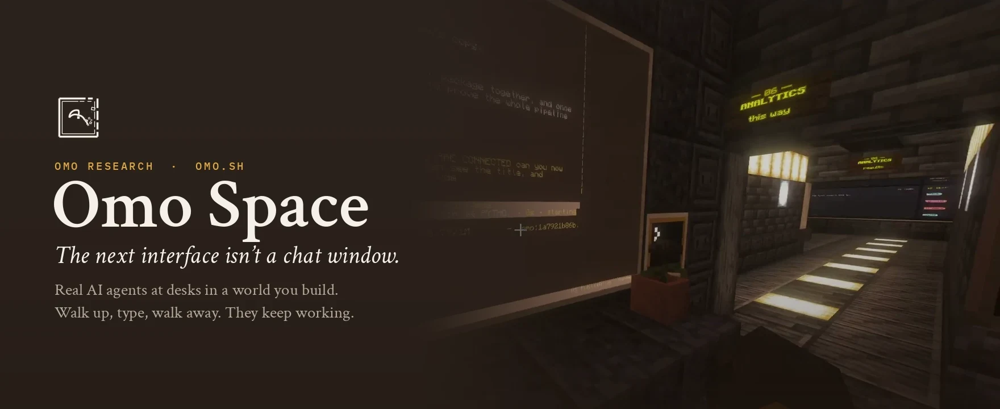
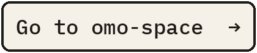

<p align="center">
  <sub><code>Moved</code> &nbsp; <code>Omo Space</code> &nbsp; <code>MIT</code> &nbsp; <code>Minecraft Java 26.2</code></sub>
</p>

<p align="center">
  <a href="https://github.com/omoresearch/omo-space"></a>
</p>

<h1 align="center"><i>We have a new name.</i></h1>

<p align="center">
  This repo was called <b>minecraft</b> before Omo Space got its name.<br>
  The code, releases, installer and issues all live at <a href="https://github.com/omoresearch/omo-space"><b>omoresearch/omo-space</b></a>.
</p>

<p align="center">
  <a href="https://github.com/omoresearch/omo-space"></a>
</p>

<br>

<table align="center">
<tr>
<td align="center"><sub>NEW HOME</sub><br><a href="https://github.com/omoresearch/omo-space">omoresearch/omo-space</a></td>
<td align="center"><sub>INSTALL</sub><br><a href="https://github.com/omoresearch/omo-space#install">omo-space#install</a></td>
<td align="center"><sub>WEBSITE</sub><br><a href="https://www.omo.sh">omo.sh</a></td>
<td align="center"><sub>LIVE</sub><br><a href="https://www.twitch.tv/yiifannn">twitch.tv/yiifannn</a></td>
</tr>
</table>

<br>

<p align="center"><sub>Already cloned the old name? Point it at the new home:</sub></p>

```sh
git remote set-url origin https://github.com/omoresearch/omo-space.git
```

<p align="center"><sub>This page is archived and read-only. Made by <a href="https://www.omo.sh">Omo Research</a>.</sub></p>
